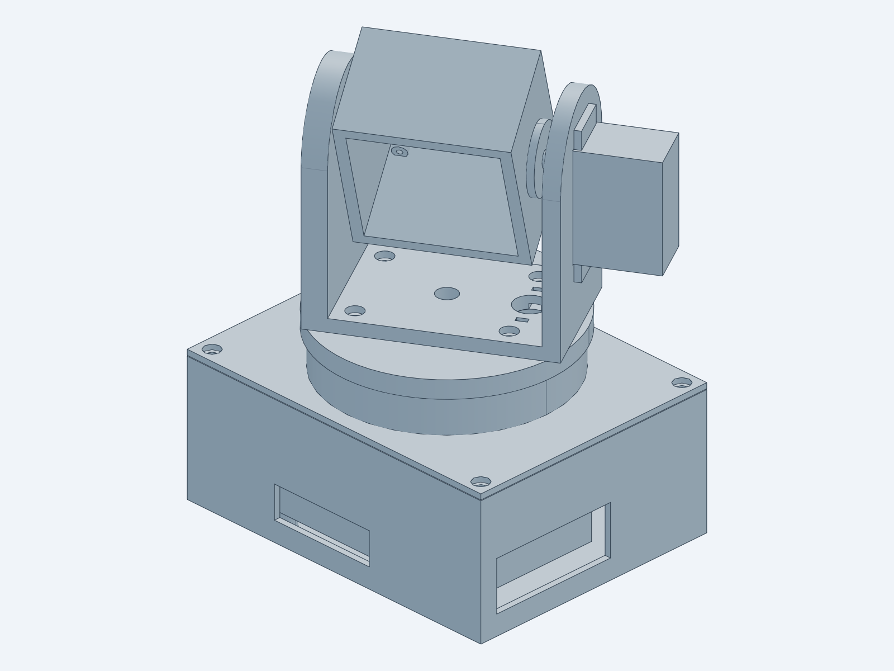

# airspace_tracker — 카메라·레이더 팬틸트 마운트 (3D 프린트)

`vision_cam` 의 공역 감시(탐지·추적·기록)용 센서 마운트. Pi Camera Module 3 와
IWR6843 mmWave 레이더를 같은 조준축에 얹고, MG996R 서보 2개로 팬(0–180°)·틸트(-10–90°)를 돌린다.
**관측·촬영 전용**이며 발사체·무력화 장치를 장착하는 구조는 없다.



## 구성

```text
hardware/airspace_tracker/
├── src/                     # build123d(cadgen) 파라메트릭 소스
│   ├── config.py            # 모든 치수·공차 (VERIFY 표시는 실측 필요)
│   ├── base_enclosure.py    # Pi 5 + PCA9685 케이스, 1/4"-20 삼각대 너트, 상단 정렬 림
│   ├── base_lid.py          # 팬 서보 고정판 + 턴테이블 스키드 링, 하단 래빗
│   ├── pan_turntable.py     # 팬 서보 혼에 고정되는 회전판
│   ├── tilt_yoke.py         # U 요크: +X 틸트 서보, -X 608 베어링, 케이블 타이 고정부
│   ├── sensor_head.py       # 카메라(상) + 레이더(하) 헤드, -X 축
│   ├── sensor_head_print.py # 출력 방향(센서면이 바닥)으로 돌린 헤드 STL
│   ├── fit_coupon.py        # 공차 시편
│   ├── servo.py, electronics.py  # 비출력 부품(서보, Pi/PCA keep-out)
│   └── assembly.py          # 전체 조립 (posed_parts(pan, tilt))
├── checks/fit_check.py      # 단일 솔리드 검증 + 12자세 간섭 + 보드 여유 거리
├── STEP/ STL/ GLB/          # 생성물
├── print/*.gcode.3mf        # Bambu P1S · PLA · 0.4 노즐 슬라이스 결과
└── preview/                 # 스냅샷
```

## 재생성·검증

[text-to-cad](https://github.com/earthtojake/text-to-cad) 의 cadgen 0.7.21 런타임을 쓴다(uv 필요).

```bash
cpy() { uvx --no-config --managed-python --python 3.13 --from cadgen==0.7.21 python "$@"; }
cd src && for m in base_enclosure base_lid pan_turntable tilt_yoke sensor_head sensor_head_print fit_coupon servo electronics assembly; do cpy $m.py; done
cd .. && cpy checks/fit_check.py      # 마지막 줄 "OK: no interference" 이어야 함
```

## 부품표 (BOM)

| 품목 | 수량 | 비고 |
|---|---|---|
| MG996R 서보 + 원형 디스크 혼 | 2 | 팬 1, 틸트 1 |
| 608 베어링 (8×22×7) | 1 | 틸트 축 반대편 |
| Raspberry Pi 5 + Active Cooler | 1 | |
| PCA9685 16ch 서보 드라이버 | 1 | I²C |
| Raspberry Pi Camera Module 3 | 1 | M2 셀프탭 4개 |
| TI IWR6843AOPEVM (또는 동급) | 1 | M2.5 셀프탭 4개 |
| 5–6V 3A 이상 서보 전원 + 5.5×2.1 배럴잭 | 1 | Pi 전원과 분리 권장 |
| M3 황동 인서트 (Ø4, 길이 ≤6) | 8 | 케이스 모서리 4, 턴테이블 4 |
| M3×10 볼트 | 8 | 뚜껑 4, 요크 4 |
| M3 셀프탭 (서보 고정) | 8 | 서보당 4 |
| M2.5×6 셀프탭 | 8 | Pi 4 + PCA 4 |
| 혼 고정 나사 (서보 동봉, Ø2.4 구멍) | 8 | 팬 4, 틸트 4 |
| 1/4"-20 너트 | 1 | 삼각대 장착 |
| 케이블 타이 (폭 ≤3.5) | 1 | 요크 하부 고정부 |

## 출력

Bambu Studio 기본 프로파일 `Bambu Lab P1S 0.4 nozzle` / `0.20mm Standard @BBL X1C` /
`Bambu PLA Basic @BBL X1C` 에 벽 3겹, 인필 25% 로 슬라이스했다.

| 파일 | 방향 | 서포트 | 예상 시간 | 필라멘트 |
|---|---|---|---|---|
| `fit_coupon` | 모델 그대로 | 없음 | 38분 | 21 g |
| `base_enclosure` | 바닥면 아래 | 없음 | 2시간 0분 | 97 g |
| `base_lid` | 평판 아래, 스키드 링 위 | 없음 | 1시간 2분 | 49 g |
| `pan_turntable` | 혼 포켓 아래(브리지) | 없음 | 34분 | 27 g |
| `tilt_yoke` | 베이스 아래 | 없음 | 1시간 13분 | 46 g |
| `sensor_head` (`_print` STL) | 센서면 아래, 열린 뒤쪽 위 | 트리(빌드판만) | 59분 | 40 g |

합계 약 6시간 26분, 280 g. **`fit_coupon` 을 먼저 뽑아** 서보·베어링·혼 나사·인서트·너트 맞춤을 확인한 뒤
`config.py` 의 `TOL` 이나 각 `*_D` 값을 고치고 다시 생성한다.

## 조립 순서

1. 케이스 모서리 4곳과 턴테이블 4곳에 M3 인서트를 인두로 삽입한다. 케이스 바닥에 1/4"-20 너트를 끼운다.
2. Pi 5(+쿨러)와 PCA9685 를 스탠드오프에 M2.5 로 고정한다. 배럴잭을 -X 벽 구멍에 단다.
3. 팬 서보를 뚜껑 위에서 내려 꽂아 M3 셀프탭으로 고정한다. 서보 축을 **90°(중앙)** 에 맞춘 뒤 혼을 끼운다.
4. 턴테이블을 혼에 혼 나사 4개로 고정한다.
5. 틸트 서보를 요크 +X 팔에 끼워 고정하고, 608 베어링을 -X 팔 바깥쪽에서 압입한다.
6. 요크를 턴테이블에 M3×10 4개로 고정한다.
7. 카메라·레이더를 헤드에 고정하고, 헤드 축을 베어링에 넣은 뒤 +X 면을 틸트 혼에 혼 나사로 고정한다(틸트 0° = 수평).
8. 케이블을 요크·턴테이블·뚜껑의 Ø12 구멍으로 내리고 요크 하부 타이 고정부로 묶는다. 팬 180° 회전분의 여유를 남긴다.
9. 뚜껑 래빗을 케이스 림에 맞춰 덮고 M3×10 4개로 잠근다.

## 실측 확인 (VERIFY)

`config.py` 에서 `VERIFY` 로 표시된 값은 데이터시트 기준이다. 출력 전에 실제 부품을 재서 고친다.

- `HORN_HOLE_R` — 동봉 디스크 혼의 나사 구멍 반지름(기본 8 mm)
- `CAM_LENS_FROM_TOP_HOLES` — 카메라 상단 구멍에서 렌즈 중심까지
- `RADAR_*` — 레이더 보드 창 크기와 구멍 피치(기본 IWR6843AOPEVM)
- `PI_COOLER_H`, `PI_PORTS_H`, `PCA_HEADER_H` — 보드 높이(서보와 여유 6.9 mm, 최소 3 mm 로 검사)

## 제약

- 팬 범위는 MG996R 표준 서보라 180° 이다. 360° 가 필요하면 연속회전 서보 + 엔코더 또는 스테퍼로 바꿔야 한다.
- PLA 는 직사광선·차량 내부 같은 고온에서 변형된다. 실외 상시 설치는 PETG/ASA 로 다시 슬라이스한다.
